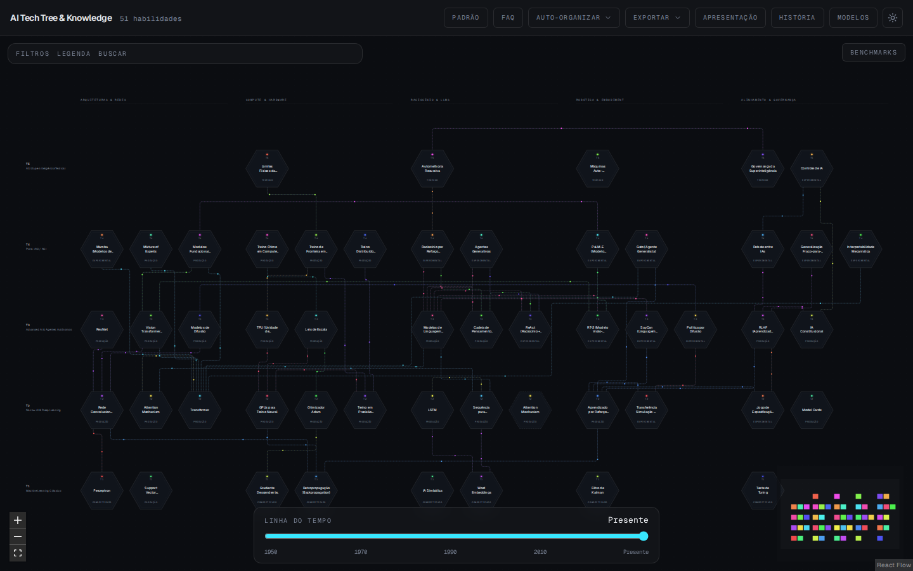
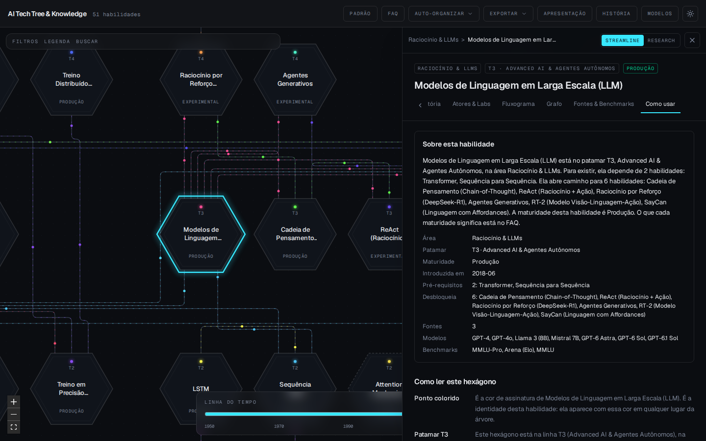
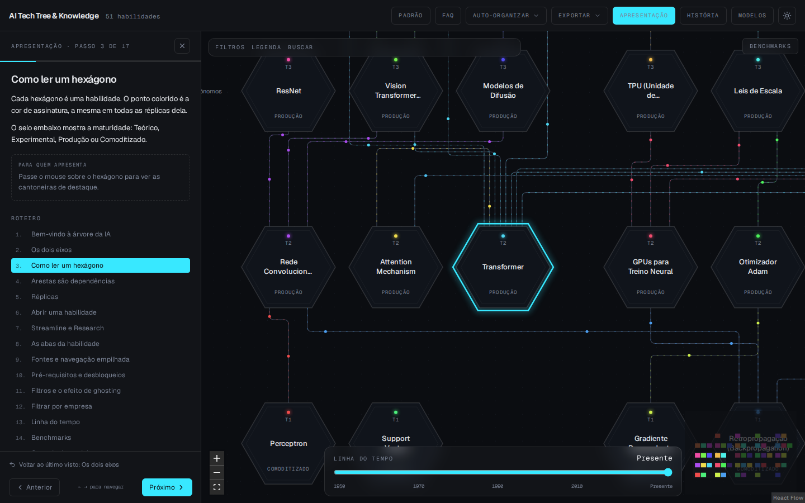
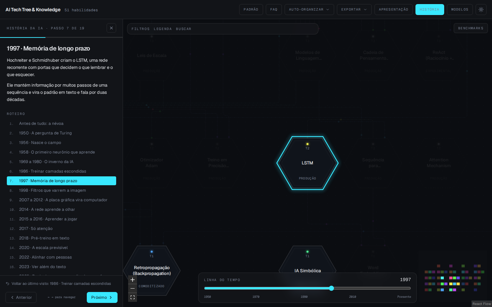
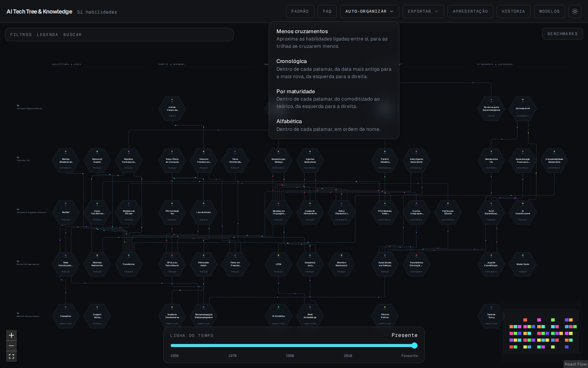
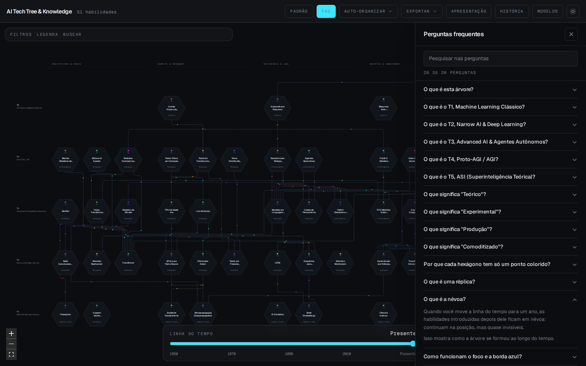
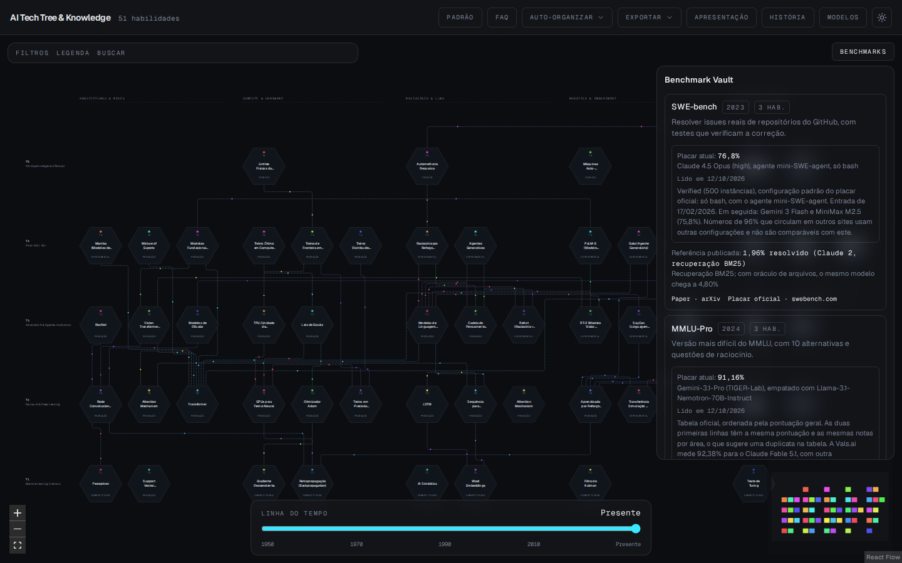
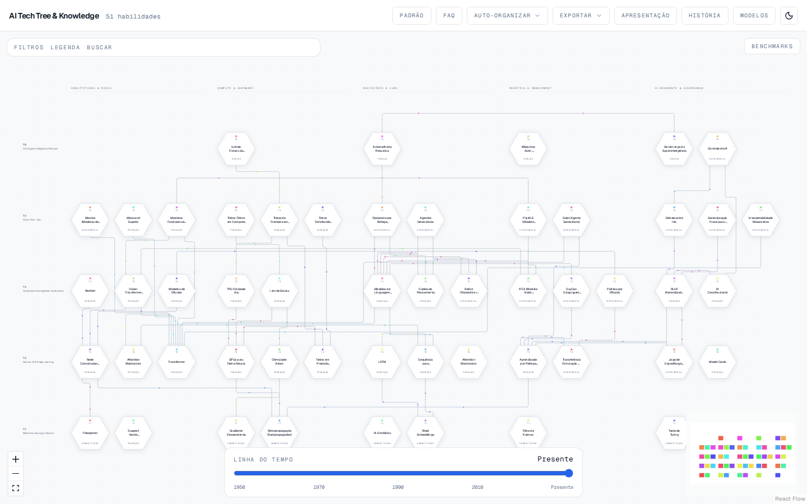
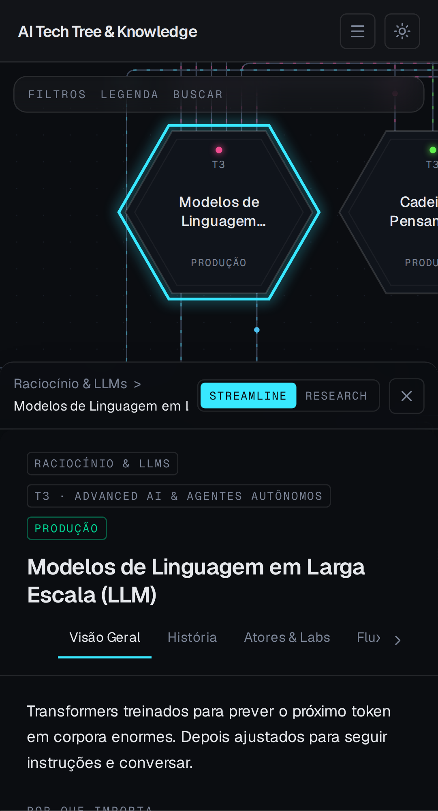
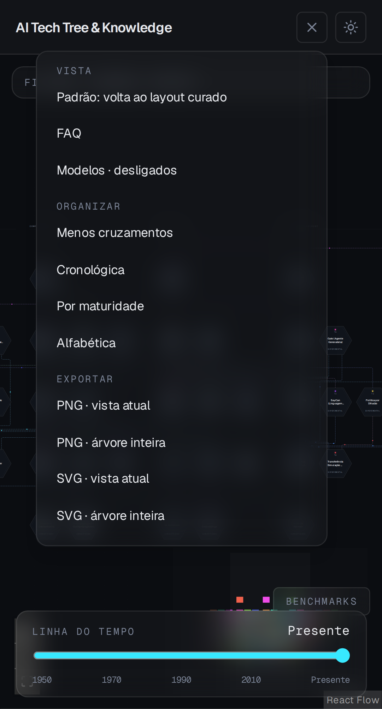

# AI Tech Tree & Knowledge

[](https://github.com/MrJc01/ai-tree/actions/workflows/ci.yml)
[](LICENSE)

**Versão no ar:** https://mrjc01.github.io/ai-tree/

Uma árvore interativa da evolução da inteligência artificial, do machine learning clássico (T1) à superinteligência teórica (T5). Cada hexágono é uma habilidade, com explicação, histórico, atores, fontes, fluxograma e benchmarks. As ligações mostram o que depende de quê.

## Prints

**Visão geral.** A árvore inteira, com as áreas nas colunas e os patamares nas linhas. As linhas tracejadas são réplicas: a mesma habilidade aparecendo em outra área.



**Gaveta da habilidade.** Cada habilidade abre numa gaveta lateral. A aba **Como usar** explica o hexágono aberto: o que cada elemento significa para essa habilidade e como usá-la.



**Apresentação.** Um roteiro de 17 passos apresenta o sistema do começo ao fim. O hexágono explicado fica em destaque, e a câmera centraliza na área livre.



**História.** Um roteiro de 19 passos conta a evolução da IA de 1950 até hoje. A linha do tempo avança junto, e o que ainda não existe fica em névoa.



**Auto-organizar.** Escolha como organizar os hexágonos: menos cruzamentos de trilhas, ordem cronológica, por maturidade ou alfabética.



**FAQ.** Perguntas frequentes com pesquisa: o que é a árvore, cada patamar (T1 a T5), cada maturidade, atalhos e como usar.



**Benchmarks.** O Vault mostra o valor publicado no artigo e o placar atual, com a data da leitura, a fonte e o link do placar oficial.



**Tema claro.** Os dois temas, claro e escuro, com o mesmo contraste.



**Celular e tablet.** Abaixo de 1024 px, os botões do cabeçalho ficam num menu. Abaixo de 768 px, a gaveta sobe por baixo ocupando 60% da tela.

| Gaveta | Menu |
| --- | --- |
|  |  |

## O que dá para fazer

- **Explorar a árvore.** 51 habilidades em 5 áreas (Arquiteturas & Redes, Compute & Hardware, Raciocínio & LLMs, Robótica & Embodiment, Alinhamento & Governança) e 5 patamares. Arraste os hexágonos (a posição fica salva no navegador), use **Auto-organizar** ou **Padrão** para voltar ao layout curado.
- **Ler uma habilidade.** A gaveta tem as abas Visão Geral, História, Atores & Labs, Fluxograma (Mermaid), Grafo (pré-requisitos e desbloqueios), Fontes & Benchmarks e Como usar. As folhas se empilham, e ESC volta uma.
- **Filtrar e viajar no tempo.** Filtros por área, empresa e maturidade (o que não combina fica esmaecido). A linha do tempo esconde em névoa as habilidades posteriores ao ano escolhido.
- **Apresentar e contar a história.** O roteiro **Apresentação** (17 passos) explica como usar o sistema. O roteiro **História** (19 passos) conta a evolução de 1950 até hoje. O botão **Voltar ao último visto** desfaz o último salto.
- **Benchmarks.** Cada um mostra o valor do artigo original e, quando há, o placar atual com a data da leitura e os links da fonte e do placar oficial. Clicar num benchmark destaca as habilidades que ele mede.
- **Modelos.** A camada de modelos mostra 19 modelos, de 2023 a 2026, orbitando as habilidades relacionadas. Cada um tem o link da página oficial do fabricante.
- **FAQ com pesquisa.** 26 perguntas, incluindo os patamares T1 a T5 e as maturidades.
- **Exportar.** Salva o canvas como PNG ou SVG, da vista atual ou da árvore inteira, com as cores do tema.
- **Links diretos.** `#habilidade=llm` abre a habilidade. Quem recebe o link vê a mesma habilidade já aberta.
- **Atalhos.** `/` busca, `ESC` fecha a folha da gaveta, as setas movem o foco entre os hexágonos, e `← →` passam os passos da apresentação.

## Como rodar

Você precisa de Node.js 22 ou mais novo.

```bash
git clone https://github.com/MrJc01/ai-tree.git
cd ai-tree
npm install
npm run dev
```

Depois abra http://localhost:5173.

## Scripts

| Comando | O que faz |
| --- | --- |
| `npm run dev` | Servidor de desenvolvimento em http://localhost:5173 |
| `npm test` | Testes de unidade e de interface (Vitest) |
| `npm run e2e` | Testes de ponta a ponta, no desktop e no celular (Playwright) |
| `npm run lint` | ESLint, com as regras do TypeScript, do React Hooks e do Fast Refresh |
| `npm run typecheck` | Checagem de tipos |
| `npm run build` | Build de produção |
| `npm run prints` | Gera os prints de `docs/img/` (precisa do `npm run dev` rodando) |
| `npm run og` | Gera `public/og-image.png`, a imagem que aparece ao compartilhar o link do site |

Os testes de ponta a ponta precisam do navegador de teste, que se instala uma vez com `npx playwright install chromium`.

## Estrutura

```
src/
  data/            habilidades (src/data/skills/), modelos e benchmarks
  lib/             geometria, roteamento das trilhas, organização, busca e exportação
  store/           estado da aplicação (Zustand)
  components/      canvas, nós, arestas, gaveta, apresentação, filtros e FAQ
  presentation/    roteiros da apresentação e da história
  guide/           FAQ, patamares, maturidades e explicação do hexágono
  __tests__/       testes de unidade e de interface
e2e/               testes de ponta a ponta
scripts/           geração dos prints do README
docs/              checklist do projeto e guia da apresentação
```

## Dados e fontes

- Cada habilidade cita as fontes que usa: artigos com arXiv ou DOI, repositórios e textos de referência. Os links abrem a fonte original.
- Os placares foram lidos em 12/10/2026 nas páginas oficiais, num navegador que executa o JavaScript dos sites. Cada um traz a data, a fonte e a configuração em que foi medido, em `src/data/benchmarks.ts`. O único que vem de um agregador é o ImageNet, que não tem placar oficial atual, e o painel diz isso.
- A revisão dos atores conferiu cada registro com a fonte. Os relatórios técnicos de empresas (Gemini, GPT-4, Llama 3, DeepSeek-R1) são atribuídos à própria empresa.
- Para adicionar uma habilidade, siga o padrão de `src/data/skills/*.ts`. `npm test` confere as ligações, as cores, as fontes e a integridade da árvore.

## Limitações conhecidas

- Outros modelos recentes, de empresas e de código aberto que não estão nesta lista, ainda não entraram. O Gemini 4 Argon aparece como anunciado, não como lançado de forma ampla.
- Gu e Dao (Mamba) e Ho (DDPM) têm a afiliação confirmada por fonte secundária, não pela primeira página dos artigos.
- O layout foi testado em 375×812 (celular), 768×1024 e 1024 px (tablet), e em 1280×800 (desktop).

## Licença

Distribuído sob a [licença MIT](LICENSE).
